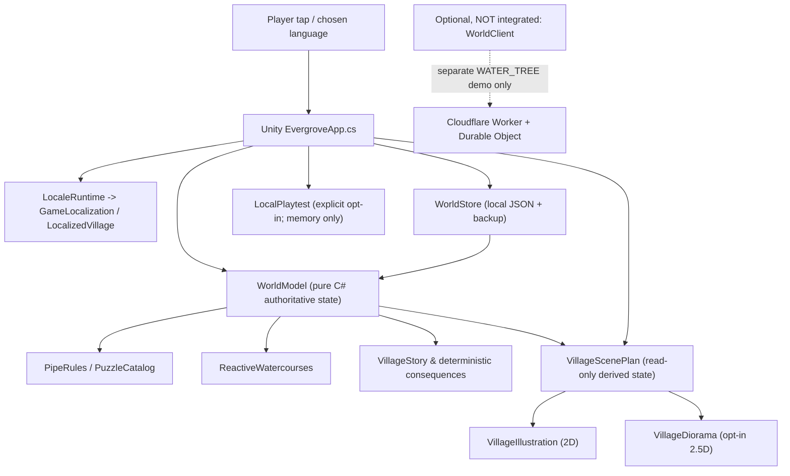

# Evergrove — engineering architecture, runtime boundaries and dependency map

**Basis:** inspected source in `games/evergrove` on 2026-11-22. Project editor pin: `6000.3.0f1` (Unity 6.3). Pure rules target .NET 8 in tests; the actual Unity client has **not been certified by running the Unity Editor or a phone build**.

## 1. The intended dependency direction

**Non-negotiable invariant:** the renderer, locale and optional backend must **not** choose what happened in the player's village. Only `WorldModel` owns puzzle orientation, active variant, event history, and progress. View layers derive what to show from that state.

## 2. Component/source map

| File | Responsibility | Guarantees / boundaries |
| --- | --- | --- |
| `Assets/Scripts/Core/PipeRules.cs` | 3×3/4×4 authored board data, port rotations, adjacency, leaks, connectivity, exhaustive uniqueness search | Pure logic; no engine or network; some arrays publicly exposed through `Puzzle` are by convention treated immutable |
| `Assets/Scripts/Core/ReactiveWatercourses.cs` | Three deterministic rotated/anchored follow-up variants per later chapter | Rotations preserve base graph; no actual resource/ecosystem dynamics |
| `Assets/Scripts/Core/WorldModel.cs` | Canonical state machine; actions, choices, schema v4 export/restore | Preserves current variant and older active boards; source of truth |
| `Assets/Scripts/Core/VillageStory.cs` | Longer authored English story logic, character responses, endings | References real choices; deterministic, not learned |
| `Assets/Scripts/Core/LocalizedVillage.cs` | Compact 30-language state-dependent game copy | 81-key localization catalog, independent of core rules |
| `Assets/Scripts/Core/GameLocalization.cs` | Language registry, BCP-47 routing/fallback, catalog checks and text formatting | Pure C# and covered by .NET tests; no state mutation |
| `Assets/Scripts/Core/VillageScenePlan.cs` | Counts and flags derived from WorldModel for both renderers | Art changes cannot independently invent facts |
| `Assets/Scripts/Core/LocalPlaytest.cs` | In-memory consent-first first-session counters and text report | No analytics SDK, identity, upload, persistent retention record |
| `Assets/Scripts/Unity/EvergroveApp.cs` | Bootstrap, safe-area scroll, touch input, puzzle UI, modes, choice, journal, language picker, sound, 2D/2.5D toggle | Imperative runtime uGUI; must be verified on real Unity/device |
| `Assets/Scripts/Unity/PipeGraphic.cs` | uGUI channel drawing from kind/orientation/win state | Pure presentation |
| `Assets/Scripts/Unity/VillageIllustration.cs` | Procedural 2D river, cottage, trees, bridge, flowers, neighbors | Original art; default rendering baseline |
| `Assets/Scripts/Unity/VillageDiorama.cs` | Optional orthographic primitive 3D diorama to 768×384 render texture; default no motion | Fallback to 2D when unsupported; camera/memory/thermal cost unmeasured |
| `Assets/Scripts/Unity/WorldStore.cs` | local save, backup recovery, v1 legacy PlayerPrefs migration | Not encrypted, not conflict-resolved multiplayer storage |
| `Assets/Scripts/Unity/LocaleRuntime.cs` | PlayerPrefs language override, bundled Resource JSON, best-effort OS fonts | RTL/Indic shaping and device glyph rendering are blockers |
| `Assets/Scripts/Unity/WorldClient.cs` | Optional separate Cloudflare `WATER_TREE` reference client | Not attached by boot; does not sync this game's true world |
| `Assets/Editor/EvergroveSceneSetup.cs` | Menu-created empty playtest scene + editor smoke | Requires a working, licensed Unity install |
| `Assets/Editor/EvergroveBuild.cs` | Android/WebGL/unsigned iOS Xcode exports | Build script exists; output not yet independently verified |
| `Tests/Program.cs` | Functional, save, solver, branch, localized 29-catalog checks | .NET validates core source, not Unity runtime/UI |

## 3. Runtime lifecycle and UI

`EvergroveApp.Bootstrap()` is marked `RuntimeInitializeOnLoadMethod(AfterSceneLoad)`; it creates the app host if none exists and marks it `DontDestroyOnLoad`. `Awake()` loads the world from `WorldStore`, reads PlayerPrefs for sound and visual modes, initializes locale, selects a font, constructs uGUI and calls `Rebuild(true)`.

UI composition is **generated in C#** rather than relying on custom prefabs. The scroll body is clipped to a safe-area-aware viewport; rotation buttons display connected-water colors, leak feedback and endpoint labels. A board action updates existing tile widgets via `RefreshBoard` rather than rebuilding the entire hierarchy on every tap. Solving a board or making a narrative choice can rebuild the view.

`EvergroveApp` switches between Living and PuzzleOnly only when `WorldModel.CanSwitchMode` permits it. A completion in Living mode offers exactly one of three decisions and a separate, non-persisted story interlude. The optional visual toggle shows either original 2D illustration or an orthographic miniature. Sound and miniature motion default off, but preferences are kept in PlayerPrefs.

**Known technical liabilities:** generated uGUI hierarchy, general scrolling, editor initialization, safe-area math, dynamic font creation and completion scrolling remain **untested** on small physical displays. The 2D/3D visual comparison is an experiment, not a production art decision. Check Unity's actual localization and input module imports before treating the project as build-ready.

## 4. Localization boundary

- **30 selectable languages:** built-in English plus 29 offline `Assets/Resources/Evergrove/Locales/*.json` bundles.
- **76 translated keys** are validated for every bundle by `tools/verify_evergrove_project.py` and .NET test. These are **draft text catalogs**, not native-reviewed localization certificates.
- `LocaleRuntime` reads optional `evergrove:language-choice:v1` from PlayerPrefs. Automatic mode resolves BCP-47/device UI culture; unsupported languages fall back to English.
- A locale selection must not change `WorldSnapshot` or puzzles. `LocalizedVillage` intentionally uses shorter canonical authored copy in all UI languages, while `VillageStory` holds richer longer English manuscript.
- `LocaleFonts` uses OS fonts as best effort; legacy uGUI `Text` does **not** guarantee Arabic/Persian/Urdu/Hebrew bidi or Indic complex shaping. Do not turn on unsupported store locales until native-speaker/device QA and correct text rendering.

Full matrix and QA: [LOCALIZATION](../LOCALIZATION.md); [player experience](PLAYER_EXPERIENCE.md).

## 5. Offline persistence and system boundaries

The only authoritative local world store is `WorldStore` and the in-memory `WorldModel`. The filename remains `evergrove-world-v2.json` while the **content schema is currently version 4** (backwards-compatible path, not a version-name mismatch to “fix” casually). Each change attempts a local validated JSON save, with a previous backup and legacy PlayerPrefs import.

There is **no** account identity, cloud sync, remote conflict resolution, multiplayer authoritative simulation or server-side live narrative. See [Save and migration](SAVE_AND_MIGRATION.md).

### Separate optional Cloudflare example

`backend/evergrove` uses TypeScript Workers + SQLite-backed Durable Objects, a capability-derived per-world object ID, optimistic revisions and one `WATER_TREE` action with limited idempotency history. It is **a security-minded reference service**, not a deployed Evergrove world backend. `WorldClient.cs` only controls that demo tree if explicitly attached and configured. A bearer capability in Unity PlayerPrefs is not secure production authentication. Do not wire in this preview by default.

## 6. Operational flow and build boundaries

- **Normal CI:** `.github/workflows/ci.yml` tests independent .NET logic, research/catalog validation and separate Godot games. Unity-specific runtime types are **not compiled** by pure domain CI.
- **Manual Unity build:** `.github/workflows/evergrove-unity-playtest.yml` requires private Unity license setup; exports Android test APK, WebGL folder or unsigned iOS Xcode project. Not app-store release.
- **Editor:** `Evergrove → Create or Open Playtest Scene` and `Verify C# Game and Scene` under Unity 6.3.
- **Quality evidence:** capture editor logs, device recordings/screenshots, crash traces, branch comparisons and raw user behavior. Do not retroactively mark those as done because the workflow definition exists.

## 7. Security, privacy and reliability posture

**Implemented:** offline local world, no third-party SDK in main loop, in-memory and optional playtest notes, structured save validation, basic recovery from a prior backup, no background cloud requests.

**Not implemented/certified:** secure local-storage encryption, privacy policy review, threat model for a cloud account, anti-tamper, telemetry consent framework, advanced accessibility/readability, native platform signing, real-world battery or crash performance. The optional remote bearer token prototype must not become a production secret store.

**Engineering guideline:** do not permit a display component to call `Choose`, mutate world arrays or diverge from `WorldModel` truth; keep any future simulation pure and record its state-change rules with deterministic tests.
