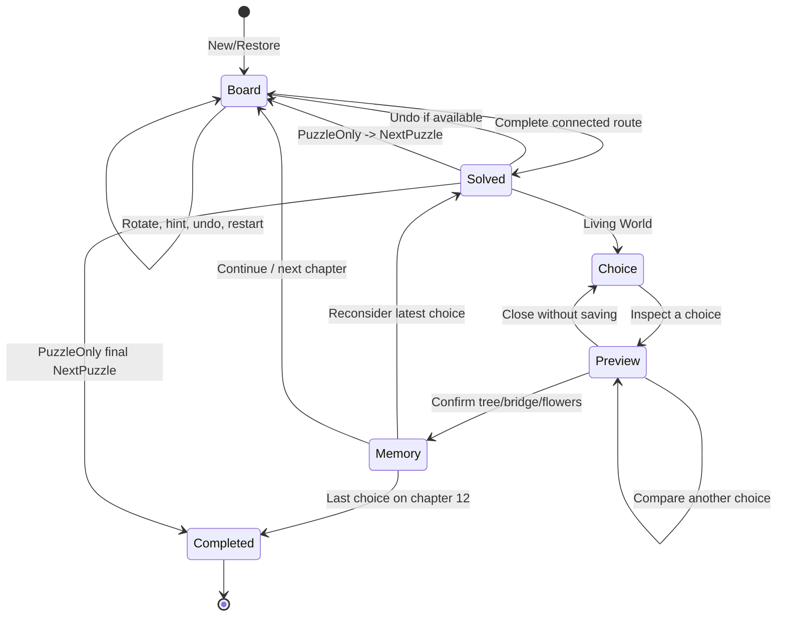

# Evergrove — exact gameplay rules and systemic consequence boundary

**Authoritative code:** [PipeRules](../Assets/Scripts/Core/PipeRules.cs), [ReactiveWatercourses](../Assets/Scripts/Core/ReactiveWatercourses.cs), [WorldModel](../Assets/Scripts/Core/WorldModel.cs), [VillageChoicePreview](../Assets/Scripts/Core/VillageChoicePreview.cs), [VillageStory](../Assets/Scripts/Core/VillageStory.cs), [VillageScenePlan](../Assets/Scripts/Core/VillageScenePlan.cs). This document describes the actual pure C# implementation; no runtime AI is implied.

## 1. Authored chapter structure

- `PuzzleCatalog.Count = 12`; chapters **1–6** use 3×3 / 9 cells and **7–12** use 4×4 / 16 cells.
- Source names in order: **First Bend, Rainwater, The Long Way, Flowing Home, Copper Run, Final Garden, Sunlit Bend, Stone Crossing, Moonwater, Winding Meadow, Old Orchard, Homeward Creek**.
- Each `Puzzle` contains `Name`, `Size`, `Kinds[]`, `Initial[]`, `Solution[]`, optionally `AnchoredTile` and `EnvironmentalRule`.
- Pipe kinds: `E` endpoint (1 port, four rotations); `I` straight (opposite ports, two rotations); `L` corner (adjacent ports, four rotations).
- Rotations are **1-based**. Directions are north=0, east=1, south=2, west=3. For an endpoint, rotation maps directly to its port. A straight at 1 is north/south; at 2, east/west. A corner at rotation `r` opens direction `r-1` and the following clockwise direction.
- The first `E` in row-major traversal is the spring; second `E` is the garden outlet. In current Unity UI, they are represented by **three blue water-wave strokes (spring)** and a **green sprout (garden)**, drawn as geometry rather than locale-specific letters. Device recognizability, contrast and screen-reader semantics remain unverified.

### Deterministic win condition

A move succeeds when the board has **exactly two endpoints**, every tile is in one connected water network reachable from the spring, and there are **zero leaks** (ports pointing outside the board or mismatched across a neighbor boundary). Every authored solution is checked for uniqueness by exhaustive search with pruning.

```text
Cell   E = one-ended / I = straight / L = bend
Tap    -> rotate the current tile to its next allowed orientation
Inspect-> count connected cells, joined edges, unmatched/open ports
Win    -> all cells connected from the source AND no leaks AND exactly two endpoints
Hint   -> align one incorrect, mutable tile to the authored reference solution
Undo   -> restore one previous board snapshot, up to ten stored steps
Restart-> original initial rotations for THIS specific board variant
```

The `PipeInsight.Leaking[]` array marks which tiles participate in a mismatch or expose a port outside the board. Unity displays a **hollow circle** at an open join, providing an additional non-color clue; this is **not** a certified accessibility or contrast test.

The game does **not** rely on a score, time limit, luck or hidden randomness. The board source and renderer receive a copied rotation array, not permission to mutate authoritative state.

## 2. The causal loop introduced in v3

**Before chapter 2**, every player experiences the same first puzzle. Only after solving a chapter in **Living** mode does the player select one of three ecological actions:

| Saved choice (`VillageChoice`) | Numeric value | Next board variant | Legend | Protected tile |
| --- | ---: | ---: | --- | --- |
| ShadeTree | 0 | 1 | Living roots | A non-endpoint pipe fixed in a roots area |
| Bridge | 1 | 2 | Bridge foundation | A non-endpoint pipe fixed by a crossing |
| Flowers | 2 | 3 | Wildflower sanctuary | A non-endpoint pipe fixed to protect a habitat |
| No choice / PuzzleOnly / old active board | — | 0 | Original authored puzzle | None |

**Detailed algorithm** (`ReactiveWatercourses.ForChapter(chapter, variant)`):

1. Load the **original** `PuzzleCatalog.Get(chapter)`. `variant=0` returns it unchanged.
2. For variants 1/2/3, **rotate every cell's location and ports clockwise** by 90°/180°/270°. Initial and solution orientations transform together.
3. Choose a protected non-endpoint tile deterministically: start at `(chapter * 7 + variant * 5) % cellCount` and scan forward to the first non-`E` cell.
4. Set that tile's initial orientation equal to its solution, and mark `AnchoredTile` and `EnvironmentalRule`. The tile cannot rotate and is rendered with a distinct warm background/badge.
5. Preserve the transformed board's original unique solution; it is still solved by matching every connection.
6. Save the **actual** `boardVariant` and the prior `lastSolvedVariant`; on reopening a previous choice the exact prior board is used.

The **11 later chapters × 3 variants = 33 possible choice-specific board presentations**. These are **not** 33 extra manually authored stories or independent puzzle graphs: a rotation is graph-isomorphic to the source puzzle. The anchor reduces interaction rather than creating new connected components. Board orientation and the protected location change; the connection graph remains structurally equivalent.

**Important UX promise:** “Your past choice changes where you work and what you must protect.” **Do not** say “The game simulates complex ecology” until resource dependencies, growth, weather, scarcity and agents truly affect later physical systems.

### Inspect before committing (2026-11-26)

On a solved Living board, tapping a choice opens an uncommitted preview. `VillageChoicePreview.TryCreate` exports and restores a detached world, then evaluates the same `Choose` operation used by actual play. The source world's rotations, hint state, undo history, choices and chapter stay unchanged. Comparing another card or closing the preview does not save or advance anything.

The UI shows the projected garden consequence and the actual next protected pipe: its kind, orientation, position and initial spring reachability come from the projected board. It does not substitute a generic straight pipe. **Make this change** calls `Choose` on the authoritative world and saves the result; the existing memory interlude follows. The final chapter previews only the garden outcome because its projected `NextPuzzle` is null. PuzzleOnly and PuzzleMatched do not offer these previews.

This makes the existing rule inspectable; it adds no puzzle topology, simulated ecology, family profile or save-schema field. Domain equivalence and non-mutation are tested; the new Unity flow still requires runtime and player verification.

## 3. What players can and cannot do

| Action | Valid when | Effect | Side notes |
| --- | --- | --- | --- |
| `Rotate(tile)` | Not completed/solved; tile index valid and not anchored | Cycle orientation, capture previous board, recompute solved | A tap on the protected tile is rejected and explained: in English and Living mode, when the current variant matches the last saved choice, `LandmarkCause.For` names the choice and the board it was made on ("Your footbridge from First Bend holds this pipe in place."); otherwise the localized generic rule |
| `GuideOneConnection()` | Active unsolved board | Fix the first misaligned tile; increment cumulative hints | Not a multi-step automated solution |
| `Undo()` | Current board has a previous snapshot | Pop one prior board from the ten-step history; clear staged hint | Undo does not reimburse the hint counter |
| `Restart()` | Non-completed run | Restore `CurrentPuzzle.Initial` including fixed anchors; clear undo and staged hint | Keeps committed choices and world variant |
| `VillageChoicePreview.TryCreate(world, choice)` | Solved Living board; valid choice | Evaluate a detached result for inspection | Does not mutate, save or replace the authoritative world; invalid states return false |
| `Choose(choice)` | Living mode, solved board, one choice per finished chapter | Append choice; choose next rotated board; update history | No ability to pick all three after one solve |
| `ReconsiderLatestChoice()` | Living mode and at least one committed choice | Pop latest choice, reopen prior board solved | UI offers this during the memory interlude; core currently permits it in other states |
| `NextPuzzle()` | PuzzleOnly or PuzzleMatched, just solved | Advance to next board: original for PuzzleOnly; scheduled variant for PuzzleMatched | No environmental choice |
| `WorldModel.NewMatched(schedule)` | Schedule is 11 ints, each 1..3 | Create the M4 control: no choices or story, boards follow `schedule` | `ArgumentException` on null, wrong length or out-of-range entries; `New(PlayMode.PuzzleMatched)` is rejected; schedule is copied and cannot change mid-run |
| `WorldModel.TryRestore(snapshot)` | Save schema and board invariants valid | Reconstruct authoritative state | Rejects malformed/corrupted snapshots; not cryptographic anti-tamper |

### State machine



The `WorldModel` enters the next chapter only on successful confirmation. Both the **uncommitted preview and memory interlude are UI state**, not persisted `WorldSnapshot` states. Relaunching before confirmation restores the solved board without the pending selection. If the app is killed after confirmation and before Continue, saved progress persists but the memory moment is not guaranteed to reopen. Do not advertise crash-proof “exactly once story popup.”

## 4. Cumulative, inspectable village consequences

The authoritative source is **ordered choice history** (`int[] choices`). Counts derive from that history, not stored as mutable decorative counters. A `VillageScenePlan` reads the state and yields:

| Field / condition | Derivation in current implementation | Visible or textual effect |
| --- | --- | --- |
| `WaterRestored` | `Round > 0 || Solved` | Creek starts dry and fills after first completed stream |
| `TreeCount` | Count(ShadeTree) | Trees, leaf canopy / Mira responses |
| `CrossingCount` | Count(Bridge) | Crossing appears; further bridges change render detail |
| `FlowerCount` | Count(Flowers) | Flower patches / Fen responses |
| `HasBridge` | bridges > 0 | Bridge appears |
| `HasVisitors` | bridge > 0 **and** flowers > 0 | Visitors arrive near meadow |
| `HasButterflies` | trees > 0 **and** flowers > 0 | Butterflies appear |
| `NeighborsGather` | tree > 0 **and** bridge > 0 **and** flowers > 0 | Neighbors gather |
| `LandscapePhase` | Chapter >= 3/6/9 (0–3 phases) | Progression-sensitive scenery; **not seasons driven by a climate model** |

`VillageStory` also defines `HasShadedCrossing` (tree+bridge), `HasButterflyGrove` (tree+flowers), `HasCommunityWalk` (bridge+flowers) and `HasLivingHeart` (all three). A consequence description selects the most relevant threshold branch; there is no physical soil, irrigation demand, daily crop growth or agent autonomous planning.

### A concrete player history

```text
Chapter 1: solve First Bend -> choose tree (ShadeTree=0)
  History [0]; chapter 2 uses variant 1: rotated 90°, one protected root.
  Mira can remember the first sapling.

Chapter 2: solve that altered stream -> choose bridge (Bridge=1)
  History [0,1]; chapter 3 uses variant 2: rotated 180°, one bridge foundation.
  Crossings and trees together produce a shaded place to gather.

Chapter 3: solve -> choose wildflowers (Flowers=2)
  History [0,1,2]; chapter 4 uses variant 3: rotated 270°, one protected meadow tile.
  Butterflies and visitors become available; the three domains intersect.
```

Changing chapter 1 to **Flowers** must change chapter 2's layout. Reloading, restarting or hinting must not silently revert to the base authored board.

## 5. NPC memory and ending rules

- **Three authored people:** Mira (trees), Orin (crossings), Fen (meadows). In the original English manuscript `VillageStory.Speak(world, index)` branches according to accumulated history; no conversation text is stored or learned.
- **30-language UI:** `LocalizedVillage` uses **shorter, fixed translated copy** for all locales, even English UI; the longer English `VillageStory` prose remains in the code as an editorial reference. See [player experience](PLAYER_EXPERIENCE.md).
- The journal records one chosen action per completed Living chapter. The ending after all **12** choices distinguishes a balanced village (all types present) from a tree/crossing/flower-dominant one; it is a **hand-authored ending**, not dynamically generated history.
- **Do not overclaim:** “NPCs remember choices” means deterministic state-dependent responses, not autonomous internal goals, time-dependent memory, learning or relationships with arbitrary player inputs.

## 6. Proof and missing simulations

The .NET suite checks the base 12 boards, 33 transformed puzzles' unique solutions, anchoring, replay, branch-specific save/restore, migration, gameplay and language invariants. See [build/QA](BUILD_AND_QA.md).

**Missing systemic depth, if the research warrants it:** true coupled water/soil/plant dynamics; spatially local growth and resource constraints; meaningful opportunity costs; neighboring households that react to changing shared routes; independent agents whose goals influence reachable outcomes; bounded event chains; coherent rollback/migration. Define one testable game mechanic first, not a generic “AI world” infrastructure.


**Solve bloom (vision run 20261128-0855):** with gentle motion on, the finishing bloom reaches each tile in the order water travels along the solved stream (`FlowOrder.StepsFromSpring`, 0.07 s per step), not by straight-line distance from the spring. Reduced motion shows no bloom.

**Forced moves (vision run 20261128-0927):** `PuzzleProfile.forcedMoveCount` is now filled by `DeductionDepth.ForcedMoves`: arc consistency over edge and neighbour agreement, with the protected tile pinned. On every authored board and variant, every rotatable tile is forced (9 of 9 or 16 of 16 on the base boards), so local deduction alone solves all 45 boards and the number does not yet separate them. It is a gate for future mechanics (root stones, ecology), not a difficulty label.

**Lantern letter names your thing (vision run 20261128-0927):** in Living mode with at least one saved choice, the dusk lantern letter names the thing from the latest choice (`DayRhythm.LanternWords(day, world)`, via `GardenCatalog.For`). Otherwise the generic letter is unchanged.

**Take turns (vision run 20261128-0927):** the keeper's remark after a shared solve counts the table: two players hear the original line, three or four hear "The three of you…" or "The four of you…" (`NeighbourNotice.TogetherLine(kind, players)`). The count lives in memory only and is never saved. The four turn colours come from `TurnPalette` in four lightness steps (smallest pairwise contrast 1.36:1, was 1.03:1). The take-turns token has one hidden screen-reader caption, updated each turn ("Second player's turn, of three.", `TakeTurns.Spoken`).
