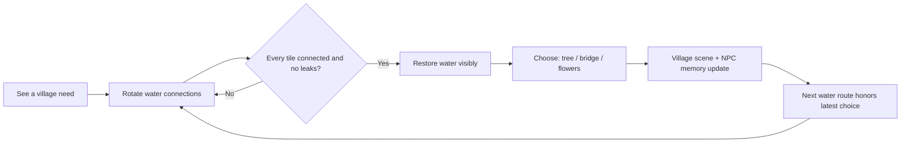

# Evergrove — product definition and commercial hypothesis

**Status:** founder-selected, mobile-first research vertical slice; **not greenlit as a market-proven game**. Internal working name only. Related selected thesis: `PH-006` in [original decision](../../../docs/research/evergrove-build-decision-2026-11-22.md).

**Companion source:** [37-feature future product backlog](specs/README.md) defines additional proposed work. This brief is the **as-built and falsifiable product thesis**, not a feature-implementation plan. Preserve the distinction between existing mechanisms and P0/P1/P2 candidates.

## 1. Product in one minute

- **Promise:** “A little world that remembers what you do.”
- **Entry mechanic:** an instantly legible spatial **pipe-rotation water puzzle**, initially 3×3 and later 4×4.
- **Emotional reward:** restore a dry creek, choose to protect trees, repair crossings or nurture wildflowers, then return to a village that visibly and consistently reflects those decisions.
- **Gameplay consequence:** from chapter 2, the prior choice rotates the next watercourse and locks one ecologically protected connection. This is a *bounded* mechanical consequence, not just decoration; it is also not a self-running ecosystem.
- **Narrative consequence:** Mira (gardener), Orin (builder) and Fen (naturalist) respond through authored, state-dependent lines and an ordered journal. No LLM invents their memories.
- **Delivery:** Unity 6.3/C#, offline-first, portrait-oriented, optional 2.5D miniature, non-coercive assistance, 30 selectable draft languages.

### Canonical repeatable loop

The puzzle → choice → consequence → next puzzle chain should fit **short voluntary sessions**; **1–3 minutes is a design hypothesis**, not measured completion time. No wall-clock timer, daily-streak compulsion, forced advertising or pay-to-continue.

## 2. Who is this for?

**Initial segment hypothesis:** people who enjoy calm, visually clear logic games and want light emotional continuity without a heavy farming/management burden. Game Foundry's studio-wide 40+ accessibility direction remains relevant; **Evergrove has not been tested with a representative 40+ cohort**, much less proved to dominate the category.

**Three distinct people must be discovered, not assumed:**

| Role | Question to validate | Evidence needed |
| --- | --- | --- |
| **Player** | Do they understand the spatial rule and care about the village consequence? | Unprompted first-use observation, independent play, spontaneous repeat |
| **Payer** | Will they pay for a clear, fair benefit without coercive monetization? | Actual pricing tests; no pricing currently committed |
| **Rejecter** | Who can block install or retention? | App-store review, family/device owner, storage/connectivity limits, accessibility, privacy concerns |

Job-to-be-done hypothesis: *“When I have a brief quiet moment, I want one satisfying puzzle that leaves a small lasting trace, without being pressured to grind, wait or manage a giant game.”*

**Family hypothesis (founder direction, 2026-11-25):** Mosselora should also be a game grandparents, parents and children play **together, gently**, so older players feel less alone and families have something to share. The adult 40+ stays the primary player; children and parents are co-players. Second job-to-be-done: *“When my grandchild visits or calls, I want something calm we can both do and talk about, where neither of us can fail in front of the other.”* Design rules, candidate features, counter-evidence and the claims ban are in [vision section 1a](../vision.md#1a-family-play-connection-not-only-entertainment). The first test is the [family co-play session](playtest/family-coplay-session.md) on the current build. **Not validated; no co-play feature exists in code.**

## 3. Competing alternatives and the claimed intersection

**Comparisons below are design lenses, not an audited 2026 feature matrix.** Specific competitor versions, live-service features, player counts and rankings must be independently verified before external use.

| Reference game family | Strength to learn from | Evergrove's testable counter-position |
| --- | --- | --- |
| Gardenscapes / Lily's Garden / Merge Mansion | Frictionless short puzzle → renovation/story progression | Try cause-and-effect that changes the *next* board, not only the garden's look; do **not** claim all competitor choices are cosmetic |
| Cozy Grove / Tsuki's Odyssey / Animal Crossing | Cozy place attachment, routine, recurring characters | Make every short session begin with an independently satisfying spatial puzzle rather than waiting or collection chores |
| Dorfromantik / Terra Nil | Spatial systems transform a beautiful landscape | Add remembered neighbor reactions and simple continuing village ownership; do **not** assert they have no systemic design |
| Reigns / Wildermyth | History, consequences and branching relationships | Test whether the same feeling can coexist with a mostly wordless, easy-entry puzzle rather than heavy narrative systems |

**Strongest alternate explanation:** players may like the *combination of art and comforting prose*, not genuine simulation; a polished pure puzzle with good cosmetic progression might be faster, cheaper and more fun. The current branch mechanic (rotations + one fixed tile) is intentionally small and may not be salient.

## 4. Product principles / anti-features

| Principle | Player-facing expression | Anti-pattern to reject |
| --- | --- | --- |
| Actions have causes | Show what changed and why; next board respects latest choice | Fake AI prose or irrelevant cosmetic rewards |
| Immediate agency | Tap to rotate; visible water reach and leak feedback | Tutorial gate, slow scripted intro, mandatory dialogues |
| Safe effort | Undo, restart, optional one-correction hint; no penalties | Difficulty jumps optimized for ad purchases |
| Attachment without manipulation | A village that grows and NPCs that remember bounded facts | Streak loss, artificial urgency, addiction metrics as objectives |
| Durable and respectful | Local progress, recoverable save, optional sound | Cloud account required for a single-player puzzle |
| Learn before scaling | Compare controlled conditions; build only what players use | Infinite AI content/platform ambitions before demonstrated demand |

## 5. What is shipped in code vs merely envisioned?

**In code:** 12 authored puzzles; 33 choice-specific follow-up transforms; unique solution solver; 3 explicit village decisions; deterministic cumulative consequence flags; authored NPC/journal/ending; 2D original art; opt-in procedural 2.5D; versioned local saves; 30-language draft catalogs; optional consent-first in-memory playtest notes.

**Not in code:** independent plant/water/weather/soil dynamics, agent goals, AI decision-making, player-to-player trading, multiplayer, generated open-world content, mobile app release, secure user accounts or monetization. The optional Cloudflare demo only waters a separate demo tree; it does not operate the local village.

## 6. Commercial model is **undecided**

No justified subscription, ad frequency, IAP price or market-size forecast exists. Do not assume mobile volume means this game has discoverability or an attractive LTV/CAC ratio. Candidate experiments **after** first-play evidence: premium one-time price versus modest free demo + fair unlock; organic ASO based on observed search terms, language-specific storefront tests, direct creator/community distribution. These are options, not approved revenue mechanics.

**Founder-led discovery** should begin with 10–30 highly relevant people, not a costly senior sales/UA team. Get the playable artifact and unprompted behavior before commissioning more content.

## 7. Success and stopping conditions

- **First-use:** players can explain *both* how water routes and what their choice changed, without coaching.
- **Value:** enough players voluntarily choose another puzzle and articulate a wish to see their village, rather than merely comply with the researcher.
- **Distinctiveness:** judge head-to-head with an actually polished reference title, not only a bare puzzle control.
- **Economics:** measurable organic intent or paid acquisition path and an ethical pricing test are prerequisites for production, not add-ons after the artwork is complete.
- **Stop/simplify:** if spatial gameplay is confusing, branch consequences aren't noticed, the narrative slows play, phone performance or script shaping is broken, or distribution has no credible wedge.

See [validation design](VALIDATION.md) for exact experiment splits and [decisions/risks](DECISIONS_AND_RISKS.md) for the strongest steel-man critique.

## 8. Naming constraint

**Evergrove is an internal codename.** Prior discussion identified an apparent name overlap with “Evergrove Idle: Grow Magic.” This note is a **clearance risk flag**, not a legal/trademark determination. Before a public listing: verify live store listings, developer identity, relevant territories/classes, naming confusion and suitable alternatives with qualified review. Avoid publishing APK metadata, logos or copy as if the name were cleared.
