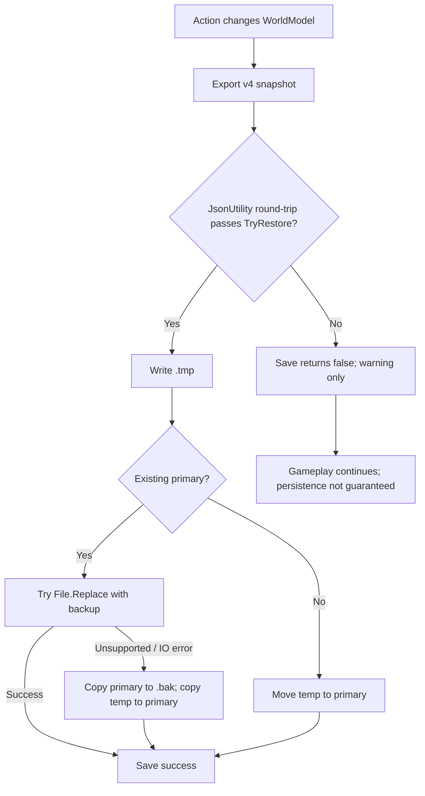

# Evergrove — save contract, corruption handling and historical compatibility

**Source of truth:** [WorldModel.cs](../Assets/Scripts/Core/WorldModel.cs) and [WorldStore.cs](../Assets/Scripts/Unity/WorldStore.cs). **Current snapshot schema: v4**. Filename `evergrove-world-v2.json` intentionally persists for compatibility.

## 1. What is saved

```json
{
  "version": 4,
  "mode": "living",
  "round": 1,
  "solved": false,
  "rotations": [1, 2, 3, 4, 1, 2, 3, 4, 1],
  "previous": [],
  "choices": [0],
  "hintsUsed": 0,
  "boardVariant": 1,
  "lastSolvedVariant": 0,
  "hintStep": 0,
  "hintTile": -1
}
```

**The JSON above illustrates the field shape only, NOT a validated example board**; rotation values must match the selected chapter's cell count, pipe orientation domains and protected tile constraint or `TryRestore` rejects it. Never paste that illustrative object into a real saved-game fixture.

| Field | Meaning | Important invariant |
| --- | --- | --- |
| `version` | Snapshot schema version | Current 3; 1/2 migration recognized |
| `mode` | `living` or `puzzle` | Strict match |
| `round` | Zero-based index of current chapter | 0..12; 12 means completed |
| `solved` | Current puzzle completed | Must equal independent `PipeRules.IsComplete` validation |
| `rotations` | Current puzzle orientation per tile | Length = current board cells (9/16), range and anchor valid; empty at completion |
| `previous` | One-step undo board snapshot | Empty or same valid grid size; empty at completion |
| `choices` | Ordered `ShadeTree=0, Bridge=1, Flowers=2` | Living: one choice per advanced chapter, length = round; PuzzleOnly: empty |
| `hintsUsed` | Number of actual helped tile corrections | First two clue stages do not increment it; nonnegative and bounded |
| `hintStep` | 0 idle; 1 row notice; 2 tile focus | Both preview stages preserve tile rotations and are saved |
| `hintTile` | Target tile index, -1 at idle | Must be currently wrong and not anchored whenever stage is 1 or 2 |
| `boardVariant` | Active puzzle geometry from prior choice | 0 base/legacy; 1 tree; 2 bridge; 3 flowers; 0 on first and completed chapter |
| `lastSolvedVariant` | Variant of previous completed board | Restores exact board on `ReconsiderLatestChoice` |

**Critical distinction:** `round` indexes 0..11 active content; player-facing UI shows 1..12. Completed `round=12` has no grid or active puzzle, but the history stays.

## 2. Example valid state transitions (conceptual)

```text
New Living game: round=0, variant=0, choices=[]
Solve first stream: round=0, solved=true, variant=0, choices=[]
Choose tree: round=1, solved=false, variant=1, lastSolvedVariant=0, choices=[0]
Solve second stream: round=1, solved=true, variant=1, choices=[0]
Choose flowers: round=2, solved=false, variant=3, lastSolvedVariant=1, choices=[0,2]
Reconsider on memory interlude:
  round=1, solved=true, variant=1, choices=[0] (same prior puzzle)
Choose bridge instead:
  round=2, solved=false, variant=2, choices=[0,1]
Final Living choice:
  round=12, solved=false, variant=0, rotations=[], choices.length=12
```

PuzzleOnly advances after a win without a choice and always uses `boardVariant=0`. The on-screen memory interlude is **not** represented by an extra persisted enum: a kill/restart will resume chapter state, not necessarily replay the interlude.

## 3. Historical migrations and file path

| Original format | Load behavior | Non-negotiable |
| --- | --- | --- |
| v1 six-chapter PlayerPrefs prototype | Imports from `evergrove:unity:world:v1` if no valid JSON primary or backup; finished chapter 6 becomes the new 4×4 chapter 7, preserving six choices | Legacy key deleted only when new file saved successfully |
| v2 twelve-chapter local JSON | Reads active board **unchanged** as variant 0; after next committed Living choice, subsequent board uses new branch variant | No retroactive rotation of an in-progress puzzle |
| v3 historical JSON | Active ecological board is preserved exactly, with staged hint reset to idle | No retroactive reorientation |
| v4 current JSON | Persists current board, last choice, hint stage and target | Reject inconsistent, anchored or already-solved hint targets |
| Unknown/faulty data | Primary then `.bak` fallback; if both invalid and no valid legacy save, starts a new world | **Potential lost-progress experience**; must surface and test device recovery before release |

The save file lives under `Application.persistentDataPath/evergrove-world-v2.json`. `.bak` contains a previous save, and `.tmp` is the transient write file. The versioned content in the file is **v4**; renaming the file to `v4` without a migration route would orphan existing progress.

## 4. Progressive hint durability and visible save failures

`WorldModel.AdvanceGentleHint()` persists `hintStep` and `hintTile` in schema v4. Step 1 identifies a row; step 2 focuses an unanchored, incorrect tile; step 3 aligns that tile, increases `hintsUsed` and resets the staged hint. Player rotation, Undo, Restart and chapter advancement clear the hint. Migrating v1/v2/v3 retains the active board and resets staged help to idle. The Unity UI now shows a localized warning when `WorldStore.Save` returns false; this does **not** make all device writes crash-atomic or guarantee recovery.

## 5. Write, recovery and failure sequence



- On load: valid primary wins; otherwise valid backup is recovered and best-effort copied back to primary; otherwise valid v1 legacy PlayerPrefs is imported; else new `WorldModel`.
- The fallback `File.Copy` path is **not a guarantee of atomic writes** on every mobile filesystem. Backup may contain an earlier state, not necessarily the most recent move.
- `Save(world)` may return **false** while UI remains playable and only logs a warning. Missing player-visible save-failure handling is a **known production risk**.
- `WorldStore.Clear()` attempts to delete primary, backup and temporary; logs individual exceptions. The UI's two-step confirmation does not guarantee every OS-level deletion succeeded.
- Local saves are **not encrypted** and have no cryptographic signature, cross-device sync, account-based recovery or cloud backup.

## 5. Invariants and extra QA

The loader checks: recognized version, mode, chapter bounds, arrays present, choice history length, per-choice enumerations, current/previous orientations, solved/unsolved truth and variant consistency with the most recent chapter choice. This is basic **data integrity**, not malicious tamper resistance.

Manual fault-injection matrix:

| Scenario | Expected behavior / evidence |
| --- | --- |
| Kill after rotating tile | Resume same board variant and orientation, or identify a genuine write failure |
| Kill immediately after choosing a tree | Choice exists once; next chapter variant 1 is stable |
| Kill during “memory moment” | History still saved; modal may not reappear (documented limitation) |
| Corrupt primary but valid backup | Recover previous valid state; show player-appropriate recovery notice in a future UX |
| Corrupt both saves | No crash; current fallback starts new game; **investigate warning/data-loss** |
| Simulate disk full/permission denied | App should not claim save succeeded; currently only warning in log |
| Upgrade v1 completed prototype | Six choices preserved; unlocked chapter 7 is playable |
| Upgrade v2 mid-chapter | Exact in-progress base board remains unchanged until next choice |
| Reconsider variant 2 | Reopen prior solved variant board, not the unrotated source |
| PuzzleOnly after full run | Completed at round=12 without fabricated village choices |
| Change language | Must not mutate `WorldSnapshot` or `LocalPlaytest`, and vice versa |
| Use anchored tile | Mutator rejects tap; solver and restored snapshot honor fixed orientation |

## 6. Evolution policy

1. Only introduce a new `WorldSnapshot` version when a real schema/rule change requires it.
2. Keep explicit migration cases for every shipped historical version, including an old *partially solved* board.
3. Generate a unique test for new puzzle variants before persisting them.
4. Add round-trip, corruption, undo, reconsider, backup and power-loss regression tests; inspect platform storage behavior.
5. Document forward/backward compatibility of game upgrades and rollback; older binaries may **not** recognize v4 saves.
6. Never silently turn an old garden into a new topology merely because the code became more expressive.

## 7. Settings vs progress

World data persists to `Application.persistentDataPath`. Separate PlayerPrefs hold language override `evergrove:language-choice:v1`, sound preference, 2D/2.5D view, optional motion and the unconnected Cloudflare demo capability. Deleting/recreating a world should not be described as revoking that demo token or erasing all OS preferences. For privacy disclosures, note local-only world state and opt-in clipboard report separately.
